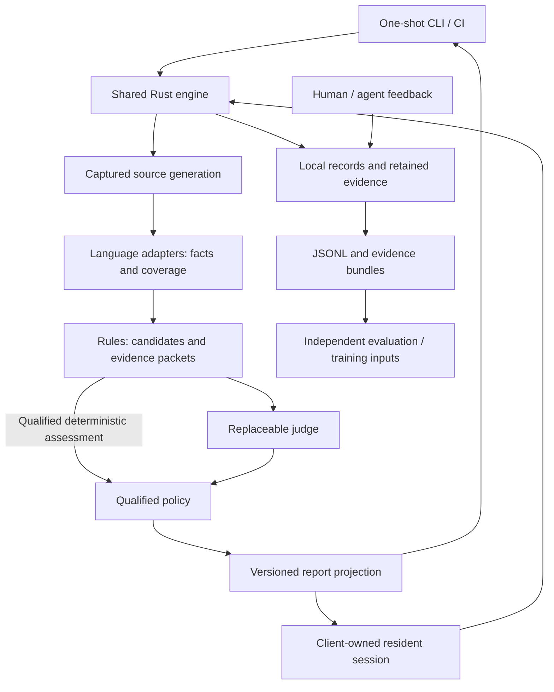

# Anti-Slop: core architecture

Date: 2026-09-22

Status: architecture proposal grounded in confirmed decisions D1–D12. D10 adds a resident mode in the first release; D11 binds its lifetime to its client session; D12 selects SQLite with JSONL/evidence exports. Interfaces, method names, module layout, and operational defaults below are proposed contracts, not implemented or performance-qualified behavior.

## Destination and authority

Define one Rust engine that supports explicit CLI/CI analysis and a client-owned resident session, preserves the evidence needed for evaluation and training, and permits independent replacement of language analyzers and semantic judges.

The [product design](2026-09-22-anti-slop-design.md) owns D1–D12, R1–R9, the output policy, and the dataset requirements. This document refines their implementation structure. All nine rule families across TypeScript, PHP, and Rust remain the scope of the first usable release. A first vertical implementation slice is a construction step, not a narrower release commitment.

Known facts and limits:

| ID | Evidence | Architectural consequence |
| --- | --- | --- |
| E1 | The repository contains design documents and qualification probes, not a production engine. | No existing runtime architecture or public interface needs preserving. Start with one Rust library and binary. |
| E2 | [Language qualification](../research/2026-09-22-language-qualification/README.md) demonstrates unequal capabilities and costs across the three languages. | Adapters report capabilities and query coverage. Rules cannot assume a universal semantic graph. |
| E3 | rust-analyzer has useful loaded-session updates but significant startup and retained memory; Mago watch mode was not automatically faster. | Session hosting enables reuse; each adapter chooses a qualified reuse strategy. Residency is not a blanket instruction to keep every process alive. |
| E4 | D10/D11 explicitly select both invocation modes, with residency ending when the client closes. | Share the engine and resource accounting. Do not install a machine-wide background service. |
| E5 | [SQLite transactions](https://sqlite.org/lang_transaction.html) provide transactional reads/writes with one concurrent writer; [atomic commit](https://sqlite.org/atomiccommit.html) depends on documented storage assumptions. | SQLite is a credible local record store. Product durability, contention, size, and latency still require direct qualification. |
| E6 | The [Jev API](https://docs.typesafe.ai/api) accepts structured state and questions, and reports answers, effective model identity, and usage. | A provider adapter can render canonical evidence without defining the rule or blocking policy. API documentation does not establish rule accuracy. |

Out of scope: the Pi package itself, Trellis O9, automatic code rewriting, a hosted collector, a distributed job system, dynamic plugins, and training a production replacement model.

## Choices and remaining uncertainty

### Execution hosting

Confirmed D10/D11: a one-shot command and a resident process owned by one client session. Each session binds to one workspace, which may contain several languages and project roots. The future Pi client can keep that process open and reuse loaded analysis state.

A service surviving its client is excluded by D11. Supporting many client processes through a machine-wide workspace broker is not needed for this interface. Independent workspace sessions remain possible; their memory adds up and must be visible to their caller.

### Record storage alternatives

These alternatives concern durable storage, not the selected TOON/JSON output or JSONL export formats.

| Option | Profile | Fit and failure conditions | Disposition |
| --- | --- | --- | --- |
| O17 — SQLite records and evidence | Conventional baseline | Transactions keep evidence and referring records together; indexed relations support feedback and exports. Fails its purpose if write contention, retained bytes, or durable-write latency exceed measured budgets. | Selected through D12; integrity and query ownership favor this option. |
| O18 — Append-only JSONL plus derived indexes | Conventional ecosystem/pattern | Easy stream inspection and ingestion. Must implement recovery from partial writes, index rebuilding, concurrent writers, and consistency across source artifacts. Attractive if append throughput and direct file consumption dominate those costs. | Not selected as the primary store: additional consistency/index ownership. Retain JSONL for exports. |
| O19 — Immutable bundle per analysis plus a catalog | Structural alternative | Each completed run is portable and independently inspectable. Feedback links, deduplication, partial-run recovery, and cross-run queries require additional coordination. Attractive when archive transfer dominates interactive use. | Not selected as the primary store: cross-run history and duplication cost. Retain self-contained bundles for exports. |

The recommendation is about integrity and implementation ownership, not a measured speed advantage. No new database dependency has been installed. Native snapshot coherence, representative corpus quality, numeric resource budgets, retention defaults, and exact codec/client libraries remain unqualified.

## Modules and ownership

Use one Cargo package with a library and a CLI binary initially. Modules are responsibility boundaries inside that package, not separate crates, processes, or services. Concrete names below make ownership reviewable; they are not a requirement to create one file per row.

| Module | Small interface | Behavior it hides |
| --- | --- | --- |
| M1 — `workspace` | Capture a source generation and select changed/affected scope; read captured source/history. | Working tree and base revision handling, relevant untracked files, project discovery, immutable source identities, path/span normalization and source consistency. |
| M2 — `analysis` | Query language facts against a generation with an explicit capability and resource budget. | Analyzer startup/reuse, readiness, native requests, process cleanup, dependency invalidation, fact caching, native-to-common mapping, and coverage. |
| M3 — `rules` | Select candidates and construct their bounded evidence requirements. | One authoritative definition per rule, language-specific applicability, counterevidence, deterministic selection, evidence assembly, and overlap between findings. |
| M4 — `judges` | Assess an evidence packet using an explicitly identified judge configuration. | Provider rendering, authentication access, request validation, bounded retries, response normalization, and provider identity. |
| M5 — `policy` | Decide an action from assessment, coverage, qualification profile, and effective configuration. | Selective blocking, required versus advisory checks, suppressions, and incomplete states. No network or analyzer access. |
| M6 — `records` | Retain a run transition with its artifacts; read reports; record feedback; export retained cases. | Transactions, evidence deduplication, record revisions, export closure, label provenance, retention, schema migration, and recovery. |
| M7 — `engine` | Start/cancel analysis and expose its current or terminal report. | Ordering between the other modules, session generations, scheduling, budgets, cancellation, progress, and terminal-state consistency. |

The CLI and session protocol adapt these interfaces. A shared output projection prepares filtering, counts, coverage, and truncation before either TOON or JSON encoding. Presentation never changes the policy decision.

Shared record and identifier types belong with their owning module and are re-exported where needed. Avoid an unrelated generic `core` full of utilities. `rules` consumes facts and source, never native SDK objects; `policy` consumes assessments, never Jev fields. `records` serializes versioned data without invoking analyzers. `engine` owns sequencing, rather than making each caller discover it.

Language and judge interfaces are justified replacement seams. A configurable implementation is enough for SQLite; a generic storage plugin framework is not currently justified. Test with a real temporary database instead of duplicating its semantics in an in-memory store.

## Execution and the resident interface

Proposed user surfaces:

- `anti-slop analyze`: run to the required terminal state, emit TOON by default or explicit JSON, and return the CI status.
- `anti-slop serve --stdio`: stay alive for one client, accept analysis requests, and preserve useful loaded state between them.
- Report, feedback, dataset-export, and evaluation commands call the same library operations; final command spelling is deferred to CLI design.

Proposed resident transport: [JSON-RPC 2.0](https://www.jsonrpc.org/specification), framed as one compact JSON value per newline using [JSON Lines](https://jsonlines.org/). Framing and resource limits are part of Anti-Slop's protocol; JSON-RPC itself is transport-independent. Standard batch requests, if used, still obey the session's work limits. Stdout carries protocol messages only; stderr carries bounded progress/debug information. This protocol does not change D6's human/agent-facing CLI default.

| Operation | Contract |
| --- | --- |
| Initialize | Negotiate protocol/schema version; report bound workspace, session identity, available capabilities and effective resource configuration. |
| Start analysis | Acknowledge an admitted run with its identity. Execution is asynchronous so report reads and cancellation remain responsive. Rejected admission is explicit. |
| Read report | Return a bounded view with run/generation identity, progress, freshness, coverage, findings, and record status. Never start analysis implicitly. |
| Cancel analysis | Request cancellation by run identity; distinguish requested cancellation from completed cleanup. |
| Record feedback | Commit a revision bound to an exact finding/evidence identity and return a durable acknowledgement. |
| Export / evaluate | Admit an explicit bounded job, return its identity, and expose completion through the same status mechanism. Avoid transferring entire datasets as one protocol message. |

Correlate protocol request IDs separately from durable run IDs. Require idempotency keys for mutations that clients may retry; conflicting reuse fails explicitly. Important operations use requests with acknowledgements, not unacknowledged notifications. Progress notifications are optional conveniences: clients can reconstruct state through report reads. Bound frames, queued output, and reads; a stalled client cannot create an unbounded memory queue.

A session owns its children. On client EOF, graceful shutdown, or cancellation of session lifetime: stop admission, cancel outstanding work, record terminal/interrupted state when possible, close native sessions, and terminate remaining owned children after a bounded grace period. Verify parent-death cleanup on supported hosts; an ordinary successful shutdown test is not proof against an abruptly killed parent.

One mutating analysis generation runs per workspace session initially. A caller may explicitly submit work with `replace_previous` semantics for repeated interactive edits; pending generations coalesce to the newest request and displaced requests receive a superseded outcome. Explicit CLI/CI jobs are not silently dropped. Assessment concurrency is separately bounded and only receives immutable packets, so source updates cannot change an in-flight provider input.

A separately invoked one-shot command owns its own analysis session; it does not automatically attach to another client's resident process. Mutable native state and managed source directories are isolated by session. Short SQLite transactions coordinate concurrent record writers. Report the presence and cumulative measured cost of other owned sessions where observable; per-session budgets do not establish a machine-wide memory cap. Clients seeking reuse should use their existing session. Cross-client attachment and a persistent broker are not first-release features.

## Source generations, freshness, and reuse

A `SnapshotId` identifies captured inputs, not just a Git commit. A `RunId` identifies an invocation; a session generation orders its requested workspace states. The snapshot manifest includes base selection, tracked/dirty/relevant untracked source identities, project configuration, dependency/toolchain identity, and analysis scope. The chosen local-change and CI-base semantics must be visible in each request/report. [Git status](https://git-scm.com/docs/git-status) distinguishes index, working-tree and untracked state; committing is not a prerequisite for analysis.

Captured source bytes are immutable for a run. Spans use a declared internal byte-offset convention with original file identity; LSP position encodings and line endings are translated by the adapter against those captured bytes. Generated locations and unmappable macro output remain explicitly unmapped. Never attach an exact source location merely because its text resembles an expansion.

**Native source consistency is a qualification gate.** Reading captured files in Rust does not prove that an external analyzer used those same files, configuration and dependencies. Waiting for an idle LSP server and hashing files before/after are not sufficient by themselves. An adapter must bind its queries to a coherent analyzer view and report the achieved consistency scope.

The reference path to qualify is a managed source view whose contents change only between generations, with dependency inputs equally bound. A resident adapter updates that view, completes its reload/update barrier, and only then answers queries. Materialization, coherent native overlays, and immutable dependency reuse are implementation alternatives to measure. Avoid mandatory whole-repository copies in the abstract interface. Mutable or untracked external inputs that cannot be bound make affected evidence incomplete and ineligible for blocking qualification.

Capture is not asserted to be a filesystem-wide atomic operation. Detect observable edits during capture, retry within bounds, and mark unstable acquisition explicitly. Distinguish a successfully analyzed captured state from whether that state still matches the client's current workspace. A changed workspace can leave a valid historical assessment which is stale for current delivery. Clients provide their current edit generation; final publication also performs the available source/dependency freshness checks. Without a fresh match, display historical/unknown freshness rather than claiming current results.

Cache facts by analyzer/configuration identity and actual input dependencies. Query scope matters: a newly added caller can invalidate a reference query even when every previously returned file is unchanged. Invalidate on project discovery, import graph, configuration, feature, dependency or toolchain changes. Use conservative project invalidation when the adapter cannot establish a smaller dependency set. Cache absence only with its declared closed scope.

Reuse an assessment only with identical assessment-relevant evidence, rule, renderer, provider configuration, and effective model identity. Changing policy alone may recompute policy from a stored assessment. A reused assessment has an explicit origin, not a fabricated new provider execution. Captured predictions are historical observations: even identical model inputs do not establish deterministic future model behavior.

## Language facts and evidence construction

The common contract contains observations needed by rules: source anchors, declarations/symbol handles, local structure, resolved relations, type observations, and attached native details where necessary. Handles are namespaced by analyzer and generation; they are not permanent cross-version symbol IDs. No universal AST or complete language-neutral type system is required.

A fact response includes query identity, generation, analyzer/version/configuration, observed facts, queried scope, unresolved/unsupported portions, source mapping quality, input-consistency status, and budget/timeout information. Successful transport is independent of completeness. An empty result with unresolved dispatch is not proof of absence.

The rule requests typed evidence questions such as declarations, references within a scope, delegation targets, or type observations. The adapter supplies supported observations or an explicit unsupported/partial response. Capability negotiation informs scheduling; it does not turn an unsupported rule into a silent success. Persist rule/language applicability and actual coverage in the run report.

| Language | Proposed adapter implementation | Required limitations |
| --- | --- | --- |
| TypeScript | Oxc for local structure; native TypeScript project semantics only for candidates requiring them. Keep access to its structured typed interface behind the same language adapter. | LSP navigation/hover is not a rich type graph. Qualify the pinned unstable typed interface and helper process; do not load redundant semantic paths without a required capability. |
| PHP | A narrow worker importing the qualified Mago PHP SDK, supervised by Rust. Reuse the SDK instead of rewriting its extraction semantics. | Reference edges lack exact call-site spans in the probe. Join only where native evidence proves the mapping; dynamic/framework gaps remain visible. Compare one-shot and retained modes before keeping it resident. |
| Rust | The provisionally selected rust-analyzer through a managed LSP session. | Preserve build-script/procedural-macro configuration and its coverage consequences. Hover/navigation/macro text do not imply a full typed graph or token-level macro mapping. Replacing the adapter may alter qualification and cost, not rule meaning. |

The initial rust-analyzer configuration follows the tested restricted execution profile. Changing it is a new capability/resource qualification. Navigation probes do not establish every structural/comment fact required by R1–R9: qualify those queries per language. Add a syntax extractor only for a demonstrated capability gap; its cost and source mapping become part of that adapter's qualification. External adapters communicate facts and errors; they do not own rule thresholds, training labels, or CI decisions. Bridge schemas are versioned once, with cross-language contract tests against the real bridge implementation.

Candidate generation uses deterministic source/fact selection. Rules define supporting evidence, legitimate counterexamples, and a stopping condition. The diff seeds discovery; necessary unchanged code, dependencies and history can be included. A bounded evidence builder follows those requirements rather than an autonomous model-driven repository exploration loop. Exhausting a bound produces explicit insufficient evidence.

Avoid a model call when no candidate requires one, an applicable assessment can be reused, or a rule's qualified definition establishes sufficient deterministic evidence. Candidate heuristics alone do not meet that last condition. Keep deterministic, newly model-assessed and reused assessment origins explicit; do not claim that every semantic family already admits deterministic verdicts.

Each immutable `EvidencePacket` contains the rule definition/version, candidate/selection provenance, supporting and counterevidence IDs, exact retained excerpts, facts, scope/coverage, unresolved requirements, and renderer-independent assessment question. Artifact IDs avoid repeatedly retaining identical source. Provider rendering may be different from CLI rendering but cannot silently omit required counterevidence.

For example, an R6 candidate starts with a delegating function, resolves its target and callers where supported, and gathers evidence of validation, authorization, ownership or dependency isolation. A useful adapter is a negative counterexample. The judge's answer does not become a fact that the analyzer extracted. Related R5/R6 signals may share artifacts; finding grouping preserves their separate assessments and presents one coherent actionable issue when appropriate.

## Replaceable judges and qualified policy

The judge interface receives a complete packet and a pinned `JudgeConfig`; it returns an execution outcome, effective identity, raw response/usage, and one normalized assessment: `supports_issue`, `rejects_issue`, or `insufficient_evidence`. A timeout, malformed response, unsupported capability or cancellation is an execution outcome, never `rejects_issue`.

Rule definitions and evidence questions are authoritative in `rules`. Provider adapters own rendering and response decoding only. For Jev, a bounded choice question can express the three outcomes; store the full raw distribution separately. The actual question mapping and renderer are versioned and require accuracy calibration. No generic confidence threshold is defined.

Routing is explicit configuration by task/rule/language and available capabilities, with budgets and an identified fallback policy. No automatic fallback inherits another model's blocking qualification. A future local or remote model implements this interface; it does not need to copy Jev's request format or score scale. Do not infer the identity or requirements of the future “Laya” model.

Retain exact transmitted request bodies and received response bodies, alongside their canonical packet and renderer version. Exclude authorization secrets. Version provider instructions; validate schema, selected evidence IDs and reported model identity. Treat source/comments as quoted evidence, not executable instructions. Diagnostics derive from source observations and attributed assessments; Jev does not supply an explanatory narrative.

Policy decides independently using a versioned `QualificationProfile`: rule and candidate-selector versions, language/project scope, analyzer/evidence contract and coverage, judge/model/renderer identity, calibration data version and approved action. Adapter replacement can require requalification even when the model stays fixed. A configured rule is not blocking merely because it is enabled.

Qualification profiles are derived from a reviewed corpus and evaluation procedure. They cannot prove that an arbitrary new repository falls within scope automatically; out-of-scope or uncertain matches stay advisory/inconclusive. CLI display filters and finding limits never alter the full policy evaluation.

## Durable records and transaction boundaries

Proposed O17 implementation: one local SQLite store per workspace, with an explicitly selectable location for CI. Default storage/cache paths must be excluded from source discovery and never become evidence recursively. Separate worktrees have separate active stores; explicit exports/imports aggregate them. Store related evidence payloads as content-addressed database blobs initially so a packet and its required artifacts can commit together. Measure size and write cost before introducing external blob files and their recovery protocol.

Logical records include runs/snapshots, artifacts, candidate-selection outcomes, packets, provider attempts, assessments, policy decisions, feedback revisions, qualification profiles, and export manifests. Runs without model calls still retain their selection/coverage outcome and required evidence. These are data relations, not a mandate for one module per table. Fact caches, native indexes, prepared output and delivery state are derived, disposable data, distinct from authoritative evidence. JSONL is a derived interchange, not a second journal to synchronously maintain.

Capture a short transaction at each meaningful boundary:

1. Admit the run and record its effective configuration/source identity as available.
2. Before judging, commit the candidate, complete packet/artifacts, exact prepared request, and attempt identity. A failed commit prevents sending an unrecordable new request.
3. After the provider responds, commit response, identity/usage and normalized assessment. Apply policy and persist its versioned result before publishing it as durably recorded.
4. Finalize execution/coverage/record status and stage metrics. A crash leaves a recoverable interrupted attempt rather than an invented terminal verdict.

No transaction stays open while waiting for an analyzer or provider. SQLite still has one writer, so serialize short writes with a bounded queue and explicit busy/backpressure handling. Qualify journal/synchronization settings and filesystem behavior; do not disable durability to meet a latency target. Schema migration failure prevents mutation and gives a recoverable error.

An external provider response and a local commit cannot be made atomic by SQLite. A crash between them leaves the attempt ambiguous. Do not promise exactly-once inference or blindly retry it as if no call occurred. Retried attempts preserve their relationship and possible duplicate cost. Read-only evaluation of stored packets does not imply that rerunning native analysis is reproducible without its dependencies/environment.

Disk full, retention limits, corruption, or failed export are explicit record failures. Already observed findings remain visible with `recording: incomplete`; the run cannot claim a complete dataset. Retention may delete eligible evidence only under an explicit policy, preserving tombstones and missing-content status. Protect pinned evaluation/export inputs. Cache eviction is independent and can be automatic; authoritative evidence must not silently become a cache.

## Feedback, datasets, and model replacement

A finding has an occurrence bound to a run/packet and a separate continuity hint for matching related findings across revisions. Only the exact occurrence is the default feedback target. Similar code or a moved line is not sufficient to transfer an adjudicated label. Prior feedback may remain visible as history; any verified equivalence/carry-forward procedure needs its own version and provenance.

Feedback is append-only revision data containing actor kind/identity, target, disposition, optional explanation and adjudication state. Correcting feedback supersedes an earlier revision instead of rewriting history. Suppression, accepted trade-off and deferred work are actions; they are not false-positive labels. An agent's explanation is not automatically a human adjudication.

Preserve model rejection, insufficient evidence, execution failure, no candidate, sampled noncandidate, manually reported miss, confirmed issue and false positive as distinct states. Candidate selection records include method/version and sampled units with selection probability/seed where applicable. Noncandidate samples are unlabeled until assessed; the absence of a finding is not a negative training target. Representative recall estimation and sampling quality still need corpus design.

Dataset export reads a consistent store view, selects a documented purpose/scope, resolves the complete artifact closure, and writes a temporary self-contained bundle. Publish its manifest only after validating content identities and record references. Include JSONL examples/feedback, retained evidence, schema and transformation versions, missing/omitted counts, label provenance, source lineage and split membership. Intentionally incomplete research exports must be marked; they are not silently trainable complete examples.

Use explicit aggregation to deduplicate case content while retaining distinct runs, origins and feedback histories. Prevent train/evaluation overlap by related repository/code lineage, clone groups and time; unresolved lineage is a limitation, not proof of independence. Freeze held-out cases before tuning candidate rules, prompts, thresholds or replacement models. Evaluate against independently adjudicated cases, not agreement with Jev alone.

Replacement workflow: contract conformance, replay/evaluation on retained packets, corpus calibration, nonblocking comparison on current workloads, then explicit policy qualification and routing change. Keep a qualified rollback configuration. This supports future fine-tuning without turning the tool into a training orchestrator.

## Errors and published outcomes

Keep separate axes in every report: execution (`running`, `completed`, `failed`, `cancelled`, `superseded`, `interrupted`), freshness, evidence coverage, assessment, policy, and durable-record status. For example, execution can complete with insufficient evidence; a valid historical assessment can be stale; a supported issue can be advisory because its scope is not qualified.

Proposed CLI exit semantics: `0` for completed work without a blocking finding or unmet required check; `1` for qualified blocking findings; `2` for invalid configuration, failed required work or required recording/export failure. If violations and operational failures coexist, the report carries both and operational failure wins the process code. Advisory incompleteness is still explicit at exit `0`; zero never means all possible rules analyzed the repository. Cancellation uses a distinct documented exit status. Validate final values with CLI contract tests.

Results from superseded generations remain historical and never replace a newer current report. Analyzer crashes invalidate affected capabilities and caches; bounded recovery starts a new qualified generation or returns incompleteness. Unavailable history limits R9 evidence. Unmapped spans, unresolved imports, dynamic dispatch and disabled macro capabilities remain attached to affected facts/packets.

## Performance and the future Pi consumer

The engine owns a resource envelope for analysis concurrency, provider concurrency, native threads, queued work, captured/retained bytes, cache size, child lifetime, packet size, deadlines and retry count. Every limit is explicit in effective configuration and reports. Defaults and numeric acceptance targets must be measured and agreed; this document invents no performance SLA. Distinguish enforced limits from observed RSS where a portable hard cap is unavailable.

Load project semantics lazily when required evidence demands them. Preserve useful resident state while under the session's budget; evict idle analyzers/caches according to measured benefit and configured policy. Record eviction/reload cost and the resulting cold/warm state. Rust-analyzer's accepted provisional cost does not authorize multiplying resident instances without accounting for them.

The future Pi package owns event scheduling and delivery history; it calls the resident interface and contains no second rule engine, policy engine, or dataset writer. A context hook reads a bounded report matching its session/current generation. It does not synchronously scan a repository or call a judge. Pending, stale and incomplete states are visible; unchanged findings are not repeatedly injected. Read latency, payload and freshness checks need separate qualification from analysis latency.

Measure p50/p95 with run counts for cold analysis, unchanged reuse, small edits, repeated edits/cancellation, idle retention, persistence/export, and report delivery. Include all child processes, external-model time/tokens and capture cost. A shorter foreground wait caused by background work is not a reduction in total resource use. No end-to-end architecture measurement exists yet.

## Verification and implementation handoff

Production behavior must follow the repository's RED → GREEN → REFACTOR policy. Use public engine/CLI/protocol interfaces, actual temporary storage, controlled native fixtures, and provider recordings or transport fakes at the external seam. Existing extraction checks are reference evidence, not substitutes for production adapter tests.

| Gate | Smallest decisive validation |
| --- | --- |
| G1 — Shared execution | Same captured inputs and judge response produce equivalent findings, coverage and policy through CLI and resident mode; session-only fields differ explicitly. |
| G2 — Source coherence | Dirty/untracked inputs, dependency changes, edits during capture/query, native reloads and stale response arrival cannot publish a mixed or falsely current packet. |
| G3 — Replacement and coverage | Each native adapter reports supported and unsupported facts correctly; a second controlled judge contract exercises replacement without reusing Jev calibration. |
| G4 — Durable provenance | Inject failure before/after request and response commits; test disk-full/busy/interruption paths, retry identities, feedback revisions, and export reconstruction from retained bytes. |
| G5 — Resident lifecycle | Read/cancel remains responsive during analysis; repeated edits do not grow queues; client exit, blocked stdout and abrupt parent termination do not leak owned analyzer processes. |
| G6 — Rule qualification | R1–R9 positive, legitimate-negative and ambiguous cases in all three languages; candidate recall separate from judge/policy precision; representative held-out evaluation before selective blocking. |
| G7 — Output and dataset fidelity | TOON/JSON equivalence and codec conformance; filtering cannot change CI policy; JSONL/artifact round trip preserves text, label provenance and split isolation. |
| G8 — Resources | Complete cold/warm/repeated-use path, including recording and owned children, meets explicitly selected budgets on documented workloads. |

Build a first complete evidence path with narrowly chosen fixtures before broadening rule coverage: source generation → actual language facts → candidate/counterevidence → controlled judge response → policy → durable record → CLI/resident report → feedback → export. Include an R6 justified-adapter counterexample to exercise semantic boundaries; a comment-only path cannot establish project-evidence correctness. This sequencing leaves the D5 release scope unchanged.

Before accepting production integrations, resolve native source-view coherence and the TypeScript/PHP/Rust contract gaps identified in qualification. Before blocking, resolve the corpus, adjudication and calibration protocol. Before claiming D8, choose numeric budgets and measure the complete implementation. Retention defaults, supported host cleanup behavior, exact libraries/versions and CLI ergonomics are remaining implementation decisions, not hidden approvals.

This phase produces an architectural design. It does not install dependencies, implement the engine, authorize paid inference, or qualify production readiness.
