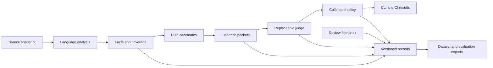

# Anti-Slop: evidence-based design analysis

> Historical design record. Accepted choices are now maintained in the [ADR index](../decisions/README.md); [ADR-003](../decisions/003-evidence-first-rules-and-selective-blocking.md) owns current rule semantics. The discussion and tables below preserve the original design context and do not override current ADRs. See the [root README](../../README.md#current-status) for implemented behavior.

Date: 2026-09-22

Status: D1–D17 confirmed with the user. Initial language extraction experiments are complete; rust-analyzer is provisionally retained with its observed resource cost under D9. The [core architecture proposal](2026-09-22-anti-slop-architecture.md) now includes selected retention, resource targets, deadlines, storage threshold and performance repositories. A source-coherence experiment passes 20 focused checks. Production integration, achievement of the resource targets and rule quality remain unqualified. These documents do not report an implemented product.

Working project name: `anti-slop`. Product commands, diagnostics, schemas, documentation, and code are in English.

## Destination

Build a Rust tool that analyzes agent-produced changes in TypeScript, PHP, and Rust with repository context, identifies unnecessary design complexity, runs explicitly both locally and in CI, and naturally records evidence and feedback for evaluating and training replaceable semantic judges.

Low latency and controlled memory use are primary reasons for choosing Rust. The same engine must support a future Pi package that injects relevant results into agent context, inspired by Pi-lens. Building that package is a later milestone; its repeated-use workload informs core qualification now.

The intended result is an evidence-backed design analyzer. Existing linters, type checkers, tests, and security tools continue to own their respective checks.

## Research and interpretation of the discussion

The seven exchanges in [Parler du modèle Jev](chatgpt-conversation://6aafe945-690c-83ea-be7a-f6e1d62683d4) were analyzed by three Terra subagents: user intent and corrections; language analysis; model contracts and datasets. Their final reports were received. A further critical pass examined provider coupling, label provenance, and incomplete analysis.

The following distinctions preserve the user's corrections:

| Discussion evidence | Consequence |
| --- | --- |
| Explicit local and CI execution was requested. | Invocation must not depend on asking an agent to remember to call Jev. |
| Fallow was mentioned for comparison, not selected. | No mandatory Fallow integration. |
| The described limitations of existing Jev lint/review wrappers were rejected, including as a testing foundation. | Those wrappers are not the implementation baseline. Their historical descriptions are not independently established product facts. |
| APOSD was adopted as the relevance filter. | A smell is a hypothesis about complexity, not a violation by name alone. |
| Duplicate Code, Primitive Obsession, Shotgun Surgery, and Speculative Generality were explicitly raised. | Each must be addressed in the design and qualification corpus. |
| The final correction allowed sufficiently capable native analyzers directly. | Tree-sitter is a conditional syntax fallback, not a mandatory layer beneath every language. |
| The final correction rejected broadening speculative abstraction just because Fowler's terminology was mentioned. | Retain the narrowed rule. Generic APIs, extension points, and single implementations are not automatically problems. |
| The current request requires native data collection and model replacement. | Neither rule semantics nor the dataset may be defined by Jev's API. |

Historical assistant examples—fixed score thresholds, a universal IR, rule numbering, and names such as `jev-lint`—were not user decisions.

### Local files examined

No existing implementation of this proposed Rust product was identified in the searched workspace manifests, names, and related source scope. This is not a claim about every file in the workspace.

Related material was inspected under `/home/abdwhb/projects/shared-services/pi-lens/`:

- `AGENTS.md` — relevant instructions and context sections.
- `README.md` and `package.json` — product boundary, runtime, and available interfaces.
- `tests/clients/tree-sitter-slop-rules.test.ts` and `tests/clients/ast-grep-antislop-error-floor.test.ts` — existing structural checks and severity qualification.
- `rules/ast-grep-rules/rules/no-unknown-returns.yml` — a concrete rule's scope and false-positive history.
- `clients/diagnostic-dispositions.ts` — distinct false-positive, suppress, defer, and flagged dispositions.
- `clients/disposition-logger.ts` and `clients/disposition-publish.ts` — feedback history and delivery.
- `clients/bounded-telemetry.ts` and `clients/degradation-ledger.ts` — operational telemetry and explicit degraded states.
- `index.ts` and `clients/runtime-context.ts` — event delivery and consumption of stored findings, including session provenance checks. This source inspection is not a runtime performance qualification of Pi-lens.

The useful precedent is the distinction between a false positive and a real problem deliberately left unresolved. The inspected feedback logger does not itself establish a complete training dataset containing the original evidence. Pi-lens is a reference, not a required dependency or a code-copying template.

### Verified external facts and remaining limits

| Component | Verified evidence | What remains unproven for this product |
| --- | --- | --- |
| APOSD | Ousterhout identifies change amplification, cognitive load, and unknown unknowns as symptoms; dependencies and obscurity contribute to complexity. Generality and comments can improve design. [Complexity](https://web.stanford.edu/~ouster/cgi-bin/cs190-winter18/lecture.php?topic=complexity), [book](https://web.stanford.edu/~ouster/cgi-bin/aposd.php). | These concepts do not supply an automatic, universal complexity score. |
| Oxc / TypeScript | Oxc exposes syntax, scopes, symbols, references, and local semantic analysis. Oxlint's type-aware path uses TypeScript's native tooling. [Pinned Oxc source](https://github.com/oxc-project/oxc/blob/fc37ba07d360c93e5f228fd00de0b0b2842429f5/crates/oxc_semantic/src/lib.rs), [type-aware linting](https://oxc.rs/docs/guide/usage/linter/type-aware). | Oxc alone is not a complete project type graph. A diagnostics interface does not establish an API for arbitrary cross-file type and reference extraction. |
| rust-analyzer | `hir` is a rich library boundary; the `ide` API is explicitly unstable while LSP is stable. Native analysis handles crate context and macros. [Architecture](https://rust-analyzer.github.io/book/contributing/architecture.html). | Required fact coverage, loading cost, maintenance cost, and macro/source mapping through the selected integration. |
| Mago / PHP | Published release 1.47.0 introduced language-neutral extension workers and a PHP SDK. Extensions expose project metadata, expression types, and references. [Release](https://github.com/carthage-software/mago/releases/tag/1.47.0), [architecture](https://mago.carthage.software/main/en/extensions/architecture/), [references](https://mago.carthage.software/main/en/extensions/analyzer/analysis-results-and-references/). | A suitable Rust worker or embedded API has not been qualified. Documentation on `main` must be checked against the selected release before implementation. Framework-specific resolution also requires tests. |
| PHPStan | Collectors support aggregation across analyzed files with AST and scope access. [Collectors](https://phpstan.org/developing-extensions/collectors). | Its extraction completeness and operational cost for the selected rule corpus. |
| Jev | The API returns typed decisions and scores, not explanatory prose. The vendor documents weaknesses with indirection, irrelevant context, counting, and related tasks. [API](https://docs.typesafe.ai/api), [limitations](https://docs.typesafe.ai/model-jaggedness/jev-1.13). | Accuracy and calibration on these rules and codebases; API conformance is not evidence of semantic correctness. |

A research correction matters: Mago's older 2.0 tracking issue initially suggested that plugins were only planned. Published release evidence contradicts that reading. Plugins already exist; embedding and Rust API stability remain separate questions.

Initial design research did not execute analyzers. A subsequent [bounded Trellis O9 experiment](../research/2026-09-22-trellis-o9/README.md) exercised its CLI and measured execution cost. The later [language qualification](../research/2026-09-22-language-qualification/README.md) executed Oxc, native TypeScript 7, a TypeScript 6 reference, Mago's PHP SDK and rust-analyzer on controlled fixtures. No production adapter, representative rule-accuracy evaluation, or paid model inference has been run.

## Confirmed decisions

| ID | Decision |
| --- | --- |
| D1 | Selective CI blocking. Only enabled rules validated on a corpus may block. Other rules remain informative. |
| D2 | A Rust core may use external language analyzers when their benefit is demonstrated. |
| D3 | Store data locally and as exportable CI artifacts. Aggregate explicitly for training and evaluation. |
| D4 | Optimize first for analyzing an agent's changes with repository context; use the same engine locally and in CI. |
| D5 | The initial usable release covers comments, the four named smells, and the pertinent APOSD rules discussed, across TypeScript, PHP, and Rust. |
| D6 | Use TOON as the default CLI output, with explicit JSON output available in the first version. Use JSONL for telemetry and dataset interchange. Keep the canonical data contract and model input formats independent of CLI encoding. Apply the AXI output principles described below. |
| D7 | Defer O9, the optional Trellis TypeScript adapter, to a future reconsideration. Its measured process cost does not fit the user's current priorities. Keep the research as a reference; do not include Trellis integration in the initial implementation or upcoming language qualification. |
| D8 | Treat latency and memory as acceptance constraints from the first release, including repeated analysis for the future Pi consumer. Evaluate the complete execution path and retained resources. Rust is the implementation choice, not evidence that those constraints are satisfied. D14/D15 subsequently select numeric targets and judge deadlines. |
| D9 | Keep rust-analyzer provisionally for Rust analysis. The user accepts its measured cost given the current small number of Rust projects and wants later replacement to remain possible. This does not choose an always-resident process or waive D8 for future workloads. Keep engine-specific integration behind the language adapter. |
| D10 | Include both a one-shot CLI and an on-demand resident mode in the first version, sharing the same Rust engine and reusing useful analyzer state between analyses. |
| D11 | Bind the resident process to its client session, such as a future Pi session. It stops when the client closes; a service surviving across client sessions is not selected. |
| D12 | Use local SQLite as the authoritative store for analyses, evidence and feedback, with self-contained JSONL/evidence exports for CI, aggregation and training. The database's exact schema, resource cost and durability behavior still require qualification; D13/D16 subsequently select retention and storage-admission preferences. |
| D13 | Retain authoritative evidence and feedback until explicit purge. Automatic cleanup is limited to reconstructible caches and technical logs. A successful export does not itself authorize deletion. |
| D14 | Adopt B1–B4 in the [architecture's performance budgets](2026-09-22-anti-slop-architecture.md#performance-budgets) as the initial report, local analysis, startup and whole-session memory targets. They are acceptance goals to validate on representative workloads, not measured product performance. |
| D15 | Use the configurable per-analysis [judge deadlines](2026-09-22-anti-slop-architecture.md#judge-deadline): 10 seconds interactive and 60 seconds in CI, including all requests and retries. Missing assessments remain explicit at expiry. |
| D16 | Apply the [storage-admission policy](2026-09-22-anti-slop-architecture.md#retention-and-storage-admission): 10 GiB per workspace, warn at 80%, then stop new collection at the threshold without automatically purging evidence. The limit is configurable. |
| D17 | Use Pi-lens, quickcoin-platform and Zerobox, alongside controlled fixtures, as the initial [performance reference workloads](2026-09-22-anti-slop-architecture.md#reference-workloads). Freeze their inputs and scenarios before measurement; they are not automatically an adjudicated rule-quality corpus. |

## Alternatives considered

| Option | Fit, complexity, and reversibility | Disposition and failure condition |
| --- | --- | --- |
| O2 — Conventional ecosystem: hybrid Rust core | Reuses native analysis through the most suitable library or process boundary. Integration costs vary by language. Adapters isolate changes without redefining rules. | Selected through D2. Reconsider an adapter if dependency burden, data loss, or process overhead defeats its demonstrated benefit. |
| O1 — Conventional baseline: everything embedded in Rust | Potentially simpler distribution and direct data access; stronger coupling to upstream Rust APIs. | Rejected as a mandatory constraint. Individual embedded adapters remain possible where qualified. Unstable APIs or insufficient extraction make this approach costly. |
| O3 — Structural alternative: independently prepared semantic artifacts | Strong separation and replay, but a separate preparation workflow and freshness burden. | Rejected as the required user workflow. Internal snapshots and exports remain useful implementation details; they do not require a second user-managed stage. |
| O4 — Contrarian: declared architecture contracts as the primary detector | Explicit expectations reduce inference, but users must anticipate and describe violations. | Rejected as the primary product. It does not sufficiently address emerging smells in ordinary agent changes. Existing contracts may still be evidence. |

No option has demonstrated performance superiority. The recommendation concerns ownership and integration boundaries, not an unmeasured speed claim.

### Trellis

| Option | Disposition |
| --- | --- |
| O8 — Research reference | Retain the inspected contracts, experiments, and counterexamples as design evidence. This adds no runtime dependency. |
| O9 — Optional TypeScript analyzer | Deferred by D7. The configured 378-file experiment measured 9.7 seconds median wall time and 461 MiB largest peak RSS, with incomplete import-graph coverage. These are bounded observations, not universal Trellis performance claims. |
| O10 — Product foundation or fork | Not selected. Its TypeScript scope and existing runtime do not provide the agreed Rust, polyglot, replaceable-judge and dataset architecture. |

Reconsidering O9 requires a concrete capability missing from the selected evidence path and new measurements demonstrating additional value within the agreed resource budgets. It is not a prerequisite for the initial three-language qualification. See the [experiment and its limitations](../research/2026-09-22-trellis-o9/README.md).

### Output formats

| Option | Fit and maintenance cost | Disposition |
| --- | --- | --- |
| O5 — TOON only | One public encoding, but every script, CI integration, and downstream data consumer needs a TOON decoder or conversion step. | Not selected: the encoding constraint adds integration work without a demonstrated benefit for all consumers. |
| O6 — TOON by default, explicit JSON | Compact agent-facing output and direct structured consumption by scripts and CI. Two encoders share one output contract and result preparation path. | Selected through D6. Qualify semantic equivalence and the actual token/latency trade-off; no universal TOON performance advantage is assumed. |
| O7 — JSON by default, explicit TOON | Conventional programmatic output, with a compact option for agents. Similar encoder maintenance to O6. | Not selected: agents would need to request TOON on each invocation instead of receiving the preferred agent-facing representation by default. |

## Rule semantics

These are diagnostic families, not nine automatic violations. Each concrete rule owns its definition, deterministic candidate selection, required evidence, counterexamples, assessment contract, and validation scope.

| ID | Family | Relevant evidence and legitimate counterexamples |
| --- | --- | --- |
| R1 | Narrating comments | Compare a comment with the associated code and interface. Preserve rationale, constraints, invariants, and non-obvious behavior. |
| R2 | Duplicated knowledge | Investigate multiple owners of the same decision or invariant. Textually similar code serving independent responsibilities is not sufficient. |
| R3 | Primitive obsession | Investigate lost domain invariants, repeated validation/conversion, or confusing interchangeable values. Primitives at transport boundaries and ordinary calculations are legitimate. A value object is not automatically the remedy. |
| R4 | Speculative abstraction | Investigate machinery for hypothetical variation that adds current complexity without a useful boundary. A single implementation, factory, hook, or generic API is insufficient. The replaceable judge in this product is a current requirement and a useful counterexample. |
| R5 | Shallow modules | Assess interface burden relative to useful behavior hidden from callers. Do not substitute line count or number of methods for this judgment. |
| R6 | Pass-through layers | Investigate delegation that preserves essentially the same responsibility across layers. Security, ownership, dependency isolation, and other useful boundaries can justify thin code. |
| R7 | Information leakage | Investigate implementation knowledge that callers or independent modules must understand. Necessary public contracts and independent domains are counterexamples. |
| R8 | Hidden protocols | Cover conjoined operations and temporal decomposition that expose internal sequencing to callers. Explicit lifecycle protocols can be legitimate. |
| R9 | Shotgun surgery | Investigate distributed coordinated changes to one concept. History may strengthen the case; fan-out, co-change, or a single broad commit alone does not establish the diagnosis. |

R2, R7, and R9 can share evidence without becoming synonyms. Report one actionable problem coherently when several signals describe the same issue. Do not multiply findings to inflate coverage.

Candidate heuristics are not proven facts about intent. In particular, naming similarity, delegation ratio, and historical co-change remain indicators. Whether an abstraction hides useful complexity is an assessment, not an exact metric extracted by a parser.

## Architecture and ownership

Start with a Rust library, CLI and client-owned resident interface organized by the responsibilities below. Separate crates or a plugin framework are not prerequisites. The [core architecture proposal](2026-09-22-anti-slop-architecture.md) specifies ownership, session lifecycle, fact/judge contracts, persistence and validation gates without changing the rule semantics here.

1. **Snapshot acquisition** identifies the exact repository state, including dirty and relevant untracked content. A commit ID alone is insufficient for local analysis.
2. **Language adapters** expose the facts required by rules, their source spans, analyzer identity, configuration, and coverage. They reuse native resolution rather than rebuilding it in the core.
3. **Rule definitions and candidate selection** are authoritative for what is being assessed. Shared behavior is implemented once; language-specific differences remain explicit.
4. **Evidence construction** gathers sufficient bounded context, including relevant unchanged code. Every packet identifies its source snapshot, rule version, facts, and unresolved evidence.
5. **Judge adapters** translate that contract to a provider. They do not privately redefine rule meaning.
6. **Policy** applies the validated rule/model/language scope and configured action. It owns blocking decisions independently of the provider.
7. **Records and exports** preserve evidence, assessments, policy actions, and feedback as distinct information. Dataset exports are derived from these records.

Use the smallest common evidence vocabulary required by the rules. Do not build a universal AST or erase native semantics to force every language into the same capabilities. A missing reference is not evidence that there are no callers; an observed count is meaningful only within its declared analysis scope.

## CLI output and AXI

AXI prescribes TOON on stdout and conversion at the output boundary, while retaining structured data internally. D6 adds an explicit JSON option for this product's integrations. The reference is the [AXI specification at commit 85a8723](https://github.com/kunchenguid/axi/blob/85a8723276ca0b9ad0a115873da7d46024bb4f4f/.agents/skills/axi/SKILL.md); it does not require the JSON option proposed here.

| Contract | Design |
| --- | --- |
| P1 — CLI | Offer `--format toon\|json`, defaulting to TOON. At identical content-selection options, both encodings expose the same information and schema version. `--full` controls detail separately. Do not switch formats automatically based on terminal detection. |
| P2 — Canonical data | Express the versioned contract through Rust types. Prepare a result once and encode it at the output boundary. Encoders do not duplicate rule logic, compute different findings, or change CI policy. Internal JSON text conversion is not an architectural requirement. |
| P3 — Dataset | Derive JSONL exports from complete retained C1/C2 records and evidence, with the provenance defined in the telemetry section. CLI previews and truncation never become the training source. JSONL interchange does not determine the local storage technology. |
| P4 — Models | Judge adapters render the canonical evidence contract into inputs appropriate for their model and API. The CLI format flag does not select a model prompt format. Replacing Jev must not require changing the public CLI encoding. |

Apply AXI's relevant output principles to the shared result preparation path:

- **A1 — Minimal views:** show a small actionable summary by default, with stable finding identifiers and access to details. Keep execution status, analysis coverage, and the policy outcome visible even when the finding list is shortened.
- **A2 — Explicit truncation:** preserve a preview, report the full size and the omitted scope, and provide the corresponding way to request full details. Both encodings carry the same truncation information.
- **A3 — Precomputed totals:** report inexpensive aggregate counts with their analysis/filter scope and distinguish displayed counts from totals. Do not imply repository-wide completeness from a partial analysis.
- **A4 — Structured outcomes:** distinguish a completed analysis with zero findings from unavailable or incomplete analysis. Emit structured results and actionable errors in the selected format on stdout; keep progress and debug logs on stderr. These presentation rules do not redefine D1's blocking policy.

TOON's documented strength is uniform structured data. The [format's own guidance](https://toonformat.dev/guide/getting-started#when-not-to-use-toon) identifies cases where compact JSON can be smaller or faster. Measure representative diagnostic lists, irregular evidence packets, and source-heavy results with the relevant tokenizer and consumer; compare equivalent content against compact JSON. No token saving or model-accuracy improvement has been established for this product. A format/profile change must remain explicit and versioned rather than depend on an unannounced per-response optimization.

Before selecting a Rust codec, qualify its supported TOON specification version and conformance fixtures, including exact preservation of retained text and values. The output contract is selected; its library implementation remains open. Additional formats require a concrete consumer need.

## Language qualification

Candidate integrations are Oxc plus native TypeScript project semantics when needed, and Mago with PHPStan as a credible alternative for PHP. D9 provisionally retains rust-analyzer for Rust; its precise production interface still requires qualification. The [initial qualification report](../research/2026-09-22-language-qualification/README.md) records exact versions, capabilities, measurements, raw evidence and 97 passing checks. Subsequent [Rust alternatives research](../research/2026-09-22-rust-analyzer-alternatives.md) records O11–O16 and the rationale for D9.

Prefer one native source that supplies the required facts. Adding another parser is justified only by a demonstrated missing capability, not by a generic polyglot design preference.

| Qualification | Smallest useful experiment | Decision it resolves |
| --- | --- | --- |
| TypeScript | Cross-file imports, aliases, a domain type, repeated validation, and an unresolved dynamic reference. Compare facts actually exposed by the candidate integration. | Whether the integration supplies the required cross-file/type evidence instead of only diagnostics. |
| Rust | A Cargo workspace with a trait, useful single implementation, conditional compilation, and macro-generated code. | Required HIR/LSP access, source mapping, coverage, loading cost, and update burden. |
| PHP | Composer autoloading, an interface implementation, repeated validation, and framework/dynamic resolution cases. | Mago worker versus PHPStan extraction, unresolved-state handling, and operational cost. |

Loading build scripts or procedural macros is an execution capability of some analyzers. The adapter must expose its configured policy and coverage when that capability is unavailable. Initial qualification uses controlled fixtures.

The completed experiments establish these bounded results:

| ID | Verified observation | Remaining integration question |
| --- | --- | --- |
| Q1 | Oxc supplies local structural facts; TypeScript 7 supplies project navigation and dependent type updates. Its separate typed API provides structured type/symbol access. | The typed API is explicitly unstable; LSP navigation and hover do not replace all structured type evidence. Qualify the chosen Rust-facing boundary. |
| Q2 | Mago's PHP SDK captures expression types, source, metadata and reference edges, with fresh dependent results after edits. Composer dependencies resolve when included in source scope. | Exact reference call-site mapping, framework behavior, evidence targeting and a possible Rust worker remain unqualified. Existing watch mode was not automatically faster than a one-shot SDK run. |
| Q3 | rust-analyzer provides fixture navigation, type/layout updates, cfg reloads and declarative macro text while build scripts and procedural macros stay disabled. | D9 accepts the observed startup and approximately 476–487 MiB retention provisionally for current use. Future Pi process lifetime, embedded HIR/IDE cost and richer macro/source mapping remain unproven. |
| Q4 | Extraction, freshness and explicit-failure checks pass on generated fixtures. | Representative R1–R9 accuracy, CI blocking, durable dataset capture and the complete Anti-Slop/Pi resource budget still require validation. |

Measurements use different operations and generated workloads; they are not a ranking of analyzers or directly comparable with the Trellis experiment. See the report for first-process, loaded-query, full-capture and memory boundaries. D14 now specifies targets for D8; meeting them remains unproven.

## Change analysis and performance

The main workflow snapshots changes after an agent finishes, then uses repository context to assess them. The diff selects changed elements; it does not bound all evidence to changed lines or an arbitrary fixed number of graph hops. The future Pi package adds repeated consumption of results; its exact analysis triggers and injection cadence are not yet selected.

Repository-wide analysis remains available for dispersed problems and evaluation. Missing history limits R9's evidence and must be visible.

Reuse facts and assessments only when their dependencies are still valid. Invalidation includes relevant source changes, shared types, project configuration, analyzer/toolchain versions, candidate logic, evidence schema, rule definition, provider instructions, and model identity. Separate reusable analysis facts from provider-specific results. This is a correctness requirement, not a commitment to a persistent daemon.

D8 applies to the whole path: startup, repository discovery, analysis, evidence construction, model requests, persistence, serialization, and delivery. D2 still permits external analyzers, but their startup, child processes, output volume, and retained memory count toward acceptance. A fast Rust coordinator cannot compensate for an unsuitable dependency merely by moving its work into the background.

Qualify these workloads on representative TypeScript, PHP, and Rust repositories, with source size, dependency shape, host conditions, and analysis coverage recorded:

| Workload | Required measurements |
| --- | --- |
| Cold first analysis | End-to-end startup and analysis latency, peak process-tree memory, and initialization I/O. |
| Warm unchanged repository | Result retrieval, freshness checks, serialization and delivery latency; work and provider calls reused or avoided. |
| Small change or edit batch | Changed and affected files/symbols analyzed, invalidation work, time to deterministic findings, and time to completed semantic assessments. |
| Repeated edits and idle periods | Latency distribution, peak and retained memory, cache/queue growth, cancellation and eviction behavior, including child processes. |
| Pi context delivery | Time added before the next model call, payload bytes/tokens, duplicate delivery, and freshness/session checks, measured separately from analysis. |

Report end-to-end latency alongside stage costs, cold/warm conditions, cache reuse, candidate count, provider calls, tokens, and cost when available. Use enough repetitions for meaningful latency distributions; the three-run Trellis experiment does not establish tail latency. Track p50 and p95 with the run count and a consistent memory measurement method. Model latency and durable data capture remain visible costs even when asynchronous.

Bound concurrent analysis, queued work, caches, evidence buffers, and child lifetimes. Expired or superseded work must not publish results as current. A budget exhaustion or unavailable assessment stays explicit; reducing evidence or skipping required work cannot manufacture a fast, complete result. Bound retries and make capture loss visible rather than silently sacrificing the dataset requirement.

The selected B1–B4 targets distinguish available-report delivery, repeated change analysis, first analysis and whole-session memory; D15 separately bounds judge waiting. Validate them before accepting a production analyzer integration, using D17's frozen reference workloads and reporting actual coverage. Performance is not postponed to a later optimization phase. D10/D11 select a client-owned resident mode from the first release. Qualify each adapter's reuse benefits against idle memory and lifecycle cost; residency does not require keeping every analyzer loaded. The proposed stdio transport and lifecycle are detailed in the core architecture document; the future Pi package has not been implemented.

### Future Pi consumer boundary

The package will connect Pi lifecycle events to the existing engine and deliver compact results. Rule selection, evidence, coverage, policy, feedback, and record generation remain owned by the Rust core; the package must not develop a second analyzer or training-data implementation.

Separate analysis scheduling from context delivery. Preparing context should consume a bounded view of available results rather than initiate a full repository scan or model assessment on each context event. Group changes and reuse valid work. Source or dependency changes invalidate affected facts and assessments; session changes invalidate delivery state without automatically discarding reusable repository facts. An unfinished assessment is pending or incomplete, never implicitly clean. The explicit CLI/CI path still waits for its required checks and applies D1.

Deliver relevant findings with stable identities, source provenance, and coverage. Avoid repeatedly injecting unchanged findings while ensuring changed, resolved, or incomplete states remain visible. Preserve valid message ordering and stable transcript prefixes; qualify actual provider-cache behavior with the future package. Its selected Pi hooks, delivery cadence, and integration tests belong to its later design. D10/D11 provide the client-owned resident engine interface without selecting per-edit invocation or a service surviving the client.

## Replaceable judge contract

A request identifies the candidate, rule definition/version, exact evidence packet, its coverage, and the question to resolve. The core owns the meaning of the outcomes; adapters only render and translate.

Separate execution status from semantic assessment:

- Execution may complete, fail, or be cancelled.
- A completed assessment may support the issue, reject it, or find the evidence insufficient.
- Policy may report, block, or retain an informative/inconclusive result according to the validated scope.

Keep raw provider distributions and confidence separately. Do not invent a universal confidence scale or reuse Jev's thresholds for a different model or prompt. Pin and record model versions when available; an unidentified changed backend cannot silently inherit an earlier qualification.

Jev cannot generate an explanation. Diagnostics therefore show actual observations and distinguish the semantic assessment. Optional bounded reason codes or supplied-evidence selections can help reporting, but are still model judgments. Future generated rationales remain attributed assessments, not new proof.

Source code and comments are input data, not instructions for the judge. Contract tests cover malformed outputs, invalid evidence references, unsupported capabilities, retries, and unavailable providers. Missing analysis must never be converted into a clean semantic result.

## Telemetry, feedback, and datasets

Maintain one authoritative local record store and evidence content. D12 selects SQLite with derived JSONL/evidence exports. D13/D16 now specify retention until explicit purge and the storage-admission threshold; transaction behavior and actual resource use remain to qualify. No central service is required by D3.

| Record | Required information |
| --- | --- |
| C1 — Analysis | Snapshot and relevant source excerpts; analyzer/configuration versions; facts and coverage; candidate selection and rule versions; exact provider input/output; model identity; latency/usage; execution status; assessment; policy outcome. |
| C2 — Feedback | Target record and snapshot; actor kind such as human or agent; disposition; optional explanation; revisions and adjudication state. |
| C3 — Export | Versioned examples derived from C1/C2, with evidence, label provenance, transformation version, and split membership. |

Capture happens naturally during normal use. Preserve approved source content, not only hashes: hashes identify examples but cannot reconstruct their training inputs. Source content belongs in controlled evidence storage and exports, not routine terminal logs. Collection scope and retention must be configurable; missing retained context is explicitly recorded.

Automatic predictions can form a weakly labelled dataset. Human and agent feedback also retain their provenance. Neither CI success, suppression, acceptance of a trade-off, nor a model's own verdict becomes adjudicated truth automatically. A verified subset supports independent evaluation and higher-quality training.

Preserve the differences between no candidate, rejected candidate, insufficient evidence, execution failure, false positive, accepted real issue, and deferred work. Exporters must not collapse these into a single negative label.

Retain rejected candidates and include a controlled sample outside candidate selection, with selection method and sampling probability. Also admit manually reported misses. Otherwise the evaluation cannot estimate what the candidate generator fails to notice.

CI produces self-contained exportable artifacts with a manifest and retained evidence. Explicit aggregation deduplicates examples and preserves provenance. JSONL is the initial interchange format selected by D6; vendor-specific training formats are generated views rather than the canonical data model.

Split evaluation data by related repository/code lineage and clone groups, with an appropriate time boundary. Do not randomly split near-identical functions or adjacent revisions across training and testing. Freeze a holdout before tuning rules, prompts, thresholds, or models. Use separately adjudicated examples to avoid proving a replacement against Jev's own labels.

The exact model meant by “Laya” was not established. Its identity, training format, and capabilities become relevant when selecting that model; the canonical evidence contract must not depend on guessing them now.

## CI policy and failure handling

D1 applies within the scope actually validated: rule, language, relevant project characteristics, evidence coverage, and judge configuration. Successful evaluation on one scope does not authorize blocking elsewhere.

Reports distinguish violations from operational incompleteness. Required checks that cannot complete surface a distinct failure/incomplete status according to CI configuration. Advisory checks may remain informative. Neither path claims complete clean analysis after an analyzer timeout or provider failure.

Also surface failed data capture or export. Existing findings do not change because persistence failed, but the run must not claim to have produced a complete dataset artifact. Bound retries and retain cancellation/partial-run provenance.

False-positive marks bind to the evidence they judged. Material source or context changes require reconsideration; unrelated formatting should not unnecessarily discard valid feedback.

## Verification and model replacement

Production behavior follows RED → GREEN → REFACTOR through the real public boundary. Tests import real modules, mock only external/nondeterministic boundaries, and do not copy rule implementations into fixtures or assertions.

- **V1 — Extraction:** real integrations on TypeScript, PHP, and Rust fixtures; cross-file facts, legitimate boundaries, macros/framework behavior, and unresolved coverage.
- **V2 — Relevance:** positive, negative, and ambiguous examples for R1–R9; candidate recall separately from assessment precision; end-to-end false-positive burden and missed issues by language and rule.
- **V3 — Contracts:** provider interchange, failures and abstention, cache invalidation, evidence freshness, feedback revisions, export round-trips, and replay from stored packets.
- **V4 — Output:** semantic equivalence of TOON and JSON through the public CLI, schema versioning, text/value round-trips, explicit truncation, structured errors, zero findings versus incomplete analysis, and dataset export completeness independent of CLI previews. Qualify the selected TOON codec against its declared specification version.
- **V5 — Resources:** reproducible cold, warm, unchanged, and repeated-edit experiments through the public boundary, with the agreed latency/memory budgets, source coverage, child-process cost, bounded retention, and telemetry capture included. Later Pi integration must also measure the actual delay and payload added to model calls.

Blocking thresholds must be selected on validation data, not the frozen evaluation set. No numeric precision, recall, or latency target is asserted as achieved by this document.

A replacement model first passes contract tests, then independent held-out evaluation and calibration, then non-blocking comparison on real workloads. Requalify relevant policies before switching blocking behavior. Retain a known qualified configuration for rollback. A lower price or higher aggregate score alone is insufficient if important rule/language cases regress.

## Handoff boundary and unresolved decisions

Initial extraction qualification for all three languages is complete within the controlled fixture scope. The core architecture proposal now specifies the shared engine, both invocation modes, adapter contracts, SQLite record ownership, retention and performance acceptance targets. The [source-coherence experiment](../research/2026-09-22-source-coherence/README.md) supports a managed source view on controlled fixtures and exposes the limit of disk-only input hashes. The next milestone is the complete rule/evidence/judge/record/export path, completion of adapter/source-coherence contracts and representative qualification. These experiments are not permission to drop the D5 scope or to advertise unsupported language/rule combinations as complete.

| Unresolved item | Impact | Reliable next step |
| --- | --- | --- |
| Exact analyzer integrations and versions | Evidence completeness, deployment, memory, and latency | Use the initial results to qualify the TypeScript structured interface, PHP call-site/framework coverage and the provisionally selected rust-analyzer interface. O9 remains deferred; O11 Rust Glancer is a possible later replacement requiring its own qualification. |
| Representative calibration corpus and label protocol | Validity of blocking and replacement claims | Define representative examples and independent review/adjudication before threshold selection. |
| Achievement of B1–B4 and judge deadlines | Performance acceptance | D14/D15 specify the targets and D17 selects reference repositories. Freeze scenarios and measure the complete path; do not confuse configured deadlines or extraction timings with passing results. |
| False-positive tolerance and blocking qualification | Quality acceptance criteria | Define an adjudicated corpus and select precision/recall/abstention criteria per validated scope before enabling blocking. The performance repositories do not supply truth labels automatically. |
| Future Pi triggers and delivery cadence; production resident protocol | Invocation frequency, user-visible latency, and idle resource use | D10/D11 select client-owned residency; qualify the proposed stdio interface and design the package after the core evidence path is qualified. Separate scheduling from delivery. |
| SQLite capture, quota accounting and retention implementation | Replay and export completeness | D12/D13/D16 settle preferences. Verify transaction boundaries, space reservation, explicit-purge behavior, failure reporting, reconstruction and cost on a small complete path. |
| Production source-generation coherence | Trustworthy facts and fresh results | Execute the SG1–SG6 protocol against config/dependency changes, overlays, late responses and concurrent edits. The new 20-check experiment covers only isolated fixture sources and explicit updates. |
| Rust TOON codec and supported specification version | Encoding fidelity and interoperability | Check conformance fixtures and public CLI equivalence; measure representative results against compact JSON. |
| Future replacement model, including the Laya reference | Training/export adapter details | Resolve the actual model when it is selected; retain provider-neutral records meanwhile. |

Out of scope for this design phase: production implementation, the future Pi package, automatic code rewriting, a hosted telemetry platform, and training a production replacement model. The product exports data and evaluates judges; it does not need to become a general training platform or agent orchestrator.

Validation performed during design: full referenced-conversation analysis, targeted local source reads, primary-source verification including AXI and TOON, completed Terra research reports and critical follow-up, and user decisions D1–D17. The Trellis experiment passed 44 focused checks and 12 source-fingerprint checks. The subsequent language experiments passed 97 extraction/freshness/failure checks and retained reproducible runtime observations, with a completed Terra investigation of Rust interface boundaries. Later Rust alternatives research verified official release metadata, versioned source and independent technical commentary; it did not rerun benchmarks. Architectural research additionally checked SQLite, JSON-RPC, JSON Lines, Git and Jev primary contracts. The new source-coherence experiment passed 20 checks using the previously verified binaries, and repository manifest inspection established the performance-corpus candidates. No production implementation, production test suite, or end-to-end Anti-Slop/Pi benchmark exists yet.
